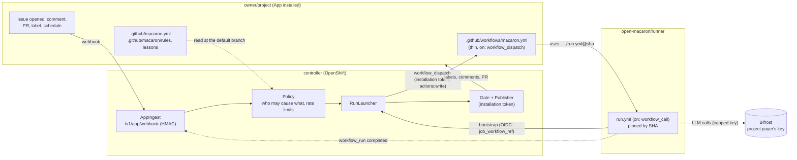
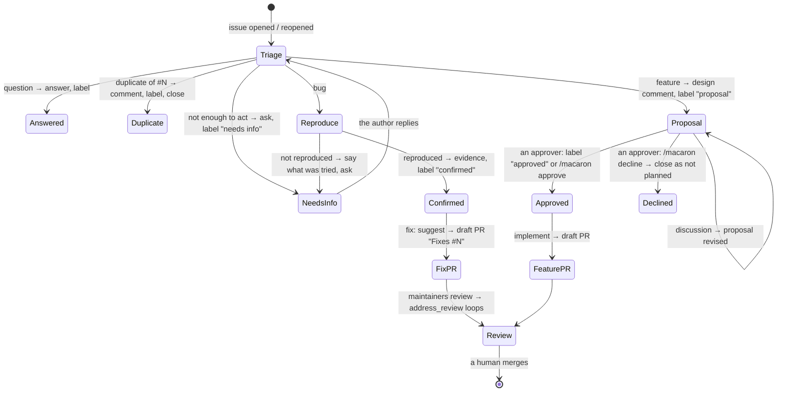

# macaron as a maintainer — design proposal

> Status: proposal, nothing implemented. It extends [DESIGN.md](DESIGN.md) and doesn't replace it: the contributor model stays as it is.

Today `macaron-bot` is an **outside contributor**: it has no access to the repositories it helps, works from forks, polls notifications, and runs only when someone with an account mentions it. Each run is billed to that person.

This document explores a second way of operating: **macaron maintains repositories it was asked to look after.** An owner installs a GitHub App on their projects; from then on the bot triages every new issue, tries to reproduce bugs, suggests fixes, proposes designs for feature requests and implements them once a maintainer approves, and keeps the labels in order. The project stays open to the community: anyone can report a bug or ask for a feature, and the bot does the first pass of maintainer work on it.

## 1. What changes, in one table

| | Contributor (today) | Maintainer (proposed) |
|---|---|---|
| Identity | User `macaron-bot`, classic PATs | A GitHub App installed on the owner's repositories, installation tokens (1 h, per repository) |
| Access to the repository | None | Issues, pull requests, labels, dispatching its own workflow; **never `workflows`, never a merge** |
| Events | Notifications polled (≥ 60 s, `X-Poll-Interval`) | App webhooks, instant; the reconcile job stays as the floor |
| Who triggers a run | A mention by someone with an account and the capability | **The repository's activity**: an issue opened, a comment, a pull request, a label, a schedule. Commands as well |
| Who pays | Whoever asked | **The project**: its payer's key, under the project's budget (§6) |
| Where the agent runs | `open-macaron/runner`, `run.yml` | **The repository's own Actions**: a thin workflow that calls a pinned reusable workflow (§3) |
| Where its configuration lives | open-macaron/config | Enrollment and budget in open-macaron/config; behaviour in the repository, `.github/macaron.yml` (§5) |
| Rules and lessons | open-macaron/knowledge | The repository, `.github/macaron/` (§8), optionally with the shared global/project folders |
| Code changes | Pushed to the bot's fork | Still the fork by default; in-repo branches opt-in (§4) |
| Labels, close, assign | Impossible | Allowed, from a fixed set, each reversible (§7) |

What does **not** change: the controller holds every credential, runners hold none, every result goes through the Gate, every run has its own capped Bifrost key, humans merge.

## 2. Architecture



**Same controller, a second profile.** Budgets, Bifrost, the ledger, the Gate, agent-cli, the review engine, settlement, `retry`/`stop` and the web app are all reused. What's new is an ingest (App webhooks), a policy layer (§7), a launcher target (the repository's own workflow) and a publisher that writes with an installation token. A repository is in one profile at a time: `access: none` (contributor, today) or `access: app` (maintainer), as DESIGN.md §4 "Later: if the bot gets minimal access" anticipated.

## 3. The runner inside the repository

The constraint from SCALING.md §1 still holds: the environment must run in the same job as the agent. A **reusable workflow** keeps the security-sensitive steps under the platform's control while the job runs in the repository's own Actions:

```yaml
# owner/project/.github/workflows/macaron.yml — added by the owner, ~15 lines
name: macaron
on:
  workflow_dispatch:
    inputs: { ticket: { required: true }, runs-on: { default: ubuntu-26.04 } }
permissions: {}
jobs:
  run:
    permissions: { id-token: write, contents: read }
    uses: open-macaron/runner/.github/workflows/run.yml@<sha>   # pinned; Renovate/Dependabot bumps it
    with: { ticket: "${{ inputs.ticket }}", runs-on: "${{ inputs.runs-on }}" }
```

- **`run.yml` gains `on: workflow_call`** next to its dispatch trigger. Checkout, bootstrap, harness, `finish` and upload stay in it; the environment step loads `./.github/macaron/env` (`source: upstream` becomes the default: the repository owns its environment).
- **The OIDC check moves from `workflow_ref` to `job_workflow_ref`.** In a called workflow the token carries `job_workflow_ref = open-macaron/runner/.github/workflows/run.yml@<ref>` and `job_workflow_sha`, while `repository_id` is the caller's. Bootstrap requires: `repository_id` in the App's enrolled installations, `job_workflow_ref` on runner's `refs/heads/main` or a released tag, `event_name=workflow_dispatch`, the actor being the App, `runner_environment=github-hosted`. A repository can't swap in its own harness: a different called workflow, or none, fails bootstrap.
- **The thin workflow can't be written by the bot.** The App has no `workflows` permission, so GitHub itself refuses any push touching `.github/workflows/`, on top of the Gate. The owner adds it once (`npx @open-macaron/init` writes it and `.github/macaron.yml`).
- **Dispatch always runs the default branch's copy**, so no branch, pull request or agent can change the workflow of the next run.
- **No repository secret reaches the job**: only referenced secrets are sent to a runner and `macaron.yml` references none.

What it buys: runs, logs and minutes live with the project (a public repository's minutes are free); each project's history is in its own Actions tab; `open-macaron/runner` keeps only the reusable workflow and shared environments. **Private repositories become possible**: transcripts stay in the repository's own, private, Actions logs (DESIGN.md §7 "Everything is public" still applies to contributor mode).

Alternative, rejected: copying the whole `run.yml` into each repository. The controller would have to trust whatever that file says (it can only see `workflow_sha`), and every harness fix would be a PR in every project.

## 4. Where code goes: fork or in-repo branch

An App can't own a fork, but the controller already has `macaron-bot`'s forks. Two options:

| | Fork (default) | In-repo branch `macaron/<n>-<slug>` (opt-in) |
|---|---|---|
| Push with | `GH_PUSH`, as today (`ForkRegistry`, `ForkCommitter`) | Installation token, contents write, ruleset restricts the App to `macaron/**` |
| PR opened by | The App, head `macaron-bot:<branch>` | The App |
| Repository CI on the PR | As a fork PR: **no secrets**; may need "Approve and run" | As a same-repo PR: **with the repository's secrets** |
| Maintainers can push to it | Yes ("Allow edits by maintainers") | Yes |

Code the bot writes is shaped by untrusted issue text. On an in-repo branch, the repository's `pull_request` workflows would run that code with secrets. So: **fork by default**; `branches: in-repo` only for repositories whose CI holds no secret, or keeps them behind environments with required reviewers. `.github/macaron.yml` documents the choice, `macaron init` asks.

## 5. Configuration, split by who owns what

- **open-macaron/config** (platform): that the installation is enrolled, its project, the payer, the monthly budget and caps, platforms and runners. Installing the App is not enough: an installation on an account not in config gets nothing but a "not enrolled" check on its first event. This stops anyone from installing the App to spend someone else's money.
- **`.github/macaron.yml`** (the owner, read at the default branch, cached by commit): what the bot does on its own.

```yaml
# .github/macaron.yml
version: 1
code: fork                       # fork | in-repo (§4)
environment: .github/macaron/env # composite action, SCALING.md §1 "upstream"
labels:                          # the bot only ever sets labels listed here (created on install)
  type: { bug: "type: bug", feature: "type: feature", question: "type: question", docs: "type: docs" }
  state: { needs-info: "needs info", confirmed: "confirmed", proposal: "proposal", approved: "approved", duplicate: "duplicate" }
  area: ["area: cli", "area: ui"]  # free list, the triage picks among them
issues:
  triage: always                 # every new issue: classify, label, dedupe, answer questions
  bugs: { reproduce: auto, fix: suggest }   # suggest: a draft PR after a reproduction; off | suggest | plan-only
  features: { propose: auto, implement: on-approval }
  close: { duplicates: true, spam: true, answered-questions: after-7d }
pulls:
  community: { review: auto, verify: on-request }   # rules from .github/macaron/rules
maintenance:
  ci-failure-on-default-branch: issue-and-fix
  stale: { after: 60d, action: ask }        # ask the author, never close silently
approvers: write                 # who can approve: repository permission (write | maintain | admin) or a team
```

A change to it is a commit to the default branch: the owner's ruleset decides who can make it. The Gate refuses any bot change under `.github/`, so the bot can't widen its own policy.

## 6. Who pays

Runs are no longer caused by a person with a key, so the payer is the **project**: one web-app account named in config as its payer (typically the owner), whose saved key and model picks Bifrost uses, exactly as USER-KEYS.md does for a user. A maintainer who types a command can still pay themselves, if they have an account (`/macaron implement --me`), otherwise the project pays.

Caps that matter more here, because strangers cause runs:

| Cap | Why |
|---|---|
| Project monthly (exists) | The hard ceiling |
| Per issue (exists: per thread) | A single long thread can't eat the month |
| **Per author per day**, lower for `FIRST_TIME_CONTRIBUTOR`/`NONE` | One person opening 50 issues gets 3 triaged, then one comment: "the bot is resting on your issues, a maintainer will look" |
| **Per repository per hour, for automatic runs** | An issue storm costs at most N triages an hour; the rest wait in the queue, oldest first |
| Tiered cost | Triage is cheap and always on; reproduce, propose and fix cost more and only follow a triage that asks for them (§7) |

When a budget is spent, automatic work stops and the bot labels new issues `needs triage` without an LLM call; commands from approvers still run if their own key pays.

## 7. The issue lifecycle



- **The state is the labels.** They're visible, maintainers can change them, and changing one is an instruction: removing `confirmed` stops a fix, adding `approved` starts an implementation (only when added by an approver, checked with `GET /repos/{o}/{r}/collaborators/{user}/permission`; the `labeled` event carries the sender).
- **Every step is an existing mode.** Triage is `triage` (its result gains `labels`, `duplicateOf`, `close`); reproduce is `reproduce`; a suggested fix is `implement` after a confirmed reproduction, whose evidence goes into the run's context; a proposal is `plan` published as a proposal; review loops are `address_review`; community pull requests get `review`. New: `escalate` across the approval gate is impossible: `plan` can't escalate to `implement` on a feature, only an approver's label can.
- **Who may cause what.**

  | Actor | Can cause |
  |---|---|
  | Anyone (rate-limited, §6) | Triage of their issue, re-triage when they answer, reproduction of a bug the triage classified, review of their pull request |
  | The issue's author | `/macaron retry` on their issue's last failed step |
  | Approvers (`approvers` in `.github/macaron.yml`) | Every command; `approve`/`decline`; changing state labels |
  | The bot itself | Nothing: its own events are dropped, as today |

- **Bot actions on GitHub are bounded by the Gate:** labels only from `.github/macaron.yml`'s list; closing only as duplicate (with a link that resolves to an open or closed issue of the same repository), spam, or answered after the configured delay, always with a comment and always reopenable by the author; never lock, never delete, never edit someone else's text, never assign anyone but itself.
- **Prompt injection gets more reach, so results get less.** An issue can now start a run with no human in the loop. What the run can do stays what the Gate allows: comments (sanitised), the label set, a draft PR from the fork that a human merges. Closing is the most visible harm and is rate-limited and reversible; `spam` closing can be turned off.

## 8. Rules and lessons in the repository

For a project the bot maintains, its knowledge belongs with the code:

```
.github/macaron/
├── env/action.yml        the environment (§3)
├── overview.md           layout, build/test quirks (today: knowledge repos/<o>/<r>/overview.md)
├── rules/<slug>.md       same format as DESIGN.md §6.2; ids `repo/<slug>`
└── lessons/<topic>.md    proposed by the bot as PRs to this repository, merged by approvers
```

- The controller reads them at the default branch (Contents API, by commit), merges them after open-macaron/knowledge's `global/` and the project's folder if the project uses them.
- `remember:` opens the lesson PR on the repository itself (from the fork, like code). The Gate refuses everything else under `.github/`, so this is the one path, and only in a `retro` run.
- `npx @open-macaron/review` reads `.github/macaron/rules` from the checkout when present: contributors run the exact review the bot will run, before pushing.

## 9. Beyond issues: maintenance

The point of "auto maintained" is that some work starts with no one asking. Each is a schedule or event that maps to an existing mode, behind a switch in `.github/macaron.yml`:

| Trigger | Run |
|---|---|
| `workflow_run` failed on the default branch | Triage the failure (logs are readable with the installation token); flaky → retry once and comment, real → an issue with the failing step and, with `issue-and-fix`, a draft PR |
| A dependency bot's PR fails CI | `implement` on that PR's branch is impossible (not the bot's): a comment with the fix, or a superseding PR from the fork |
| Weekly | Stale issues: ask the author; issues labelled `confirmed` without a PR: offer a fix; `garden` on the repository's lessons |
| A release is drafted | Release notes from merged PRs, as a comment on the draft (the App can't publish releases) |

## 10. What changes in the code

| Package | Change |
|---|---|
| contracts | `access: none \| app` per repository; `RepoPolicy` (`.github/macaron.yml`, Zod, JSON Schema for editors); `trigger.kind` gains `opened`, `labeled`, `schedule`, `ci`; triage result gains `labels`, `duplicateOf`, `close`; `payer: user \| project`. No new `Mode` is needed for the first milestones |
| controller | `github-app/` module: App JWT, installation tokens (`@octokit/auth-app`), `/v1/app/webhook` with its own secret, installation events → enrollment check; `PolicyService` (actor permission, rate limits, label set); launcher target `repo-workflow`; OIDC check on `job_workflow_ref`; publisher writes labels/closes through the installation token and still pushes code through `ForkCommitter`; payer resolution for projects; the edge exposes one more route |
| agent-cli | Unchanged contract; triage prompt learns the label set and the duplicate search (the controller passes candidate issues found by the search API, the agent never searches GitHub) |
| runner | `run.yml` callable (`workflow_call`), environment default `./.github/macaron/env` |
| review | Rules from the checkout's `.github/macaron/rules` |
| web | Project payer and per-project spend; an "Installations" admin page |
| new: `init` | `npx @open-macaron/init`: writes `macaron.yml` workflow and `.github/macaron.yml`, checks the ruleset |

## 11. Milestones

1. **App and triage.** App, webhooks, enrollment, project payer, automatic triage with labels, dedupe and answers. Triage runs in the repository's workflow (read-only, no environment), which proves the reusable workflow and the OIDC change on the cheapest mode.
2. **Bugs.** Automatic reproduction after a triage says bug; `needs info` loop with the author; draft fix PR from the fork after a confirmed reproduction.
3. **Features.** Proposals, the approval gate (label or command, permission checked), implementation, review loops.
4. **Community pull requests.** Automatic rule review from `.github/macaron/rules`; `verify` on request.
5. **Maintenance.** CI failures on the default branch, stale issues, weekly garden, release notes.
6. **In-repo branches** for repositories that opt in (§4).

A good pilot is a new project created for it, with no secrets in CI and a small `.github/macaron/rules`: the whole lifecycle can be exercised there before any existing repository moves.

## 12. Open questions

1. **Fix PRs without a human go-ahead?** Proposed: yes for bugs once reproduced (`fix: suggest`, a draft), never for features. The alternative is `plan-only` until an approver says go.
2. **Auto-merge, ever?** Proposed: no. A later, narrow exception could be docs-only or test-only changes with green CI and an approver's review, using GitHub's own auto-merge (the App enables it, the ruleset still requires the review).
3. **One App or two?** A single public App (`macaron`) enrolled per installation, or one App per owner (self-hosted controllers). Proposed: one App, enrollment in config.
4. **Does contributor mode adopt in-repo pieces?** Upstreams that adopt macaron could ship `.github/macaron/` (rules, environment) and be read even without the App. That converges both profiles on one layout.
5. **Who answers when the bot is wrong?** Approvers can `/macaron undo` its last label or close; each undo could become a lesson proposal (`retro`), so mistakes feed the knowledge base.
